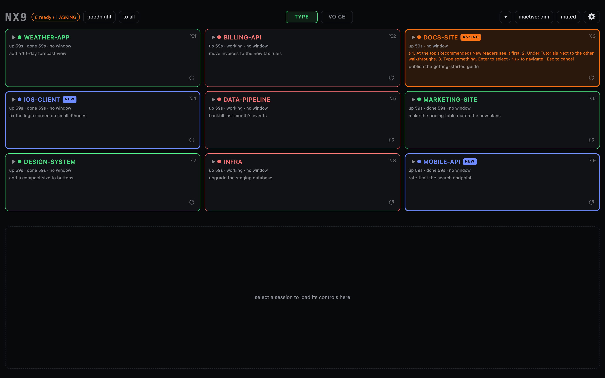
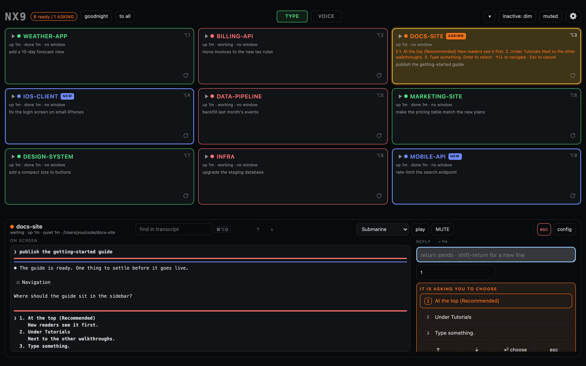
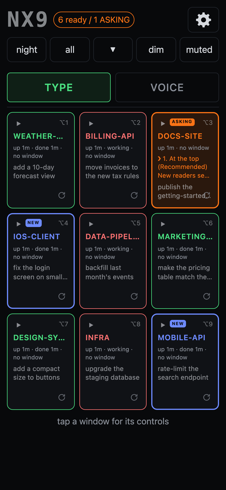

# NX9

Nine Claude Code sessions on one screen, and on your phone.

NX9 is a free Mac app from [Functional Development](https://functional-development.com).  It shows up to nine Claude Code sessions as one grid, tells you at a glance which are working, which have finished and which are waiting on you, and lets you answer any of them without going to its window.

**[Download the latest version](https://github.com/functional-dev/nx9-releases/releases/latest)**



## What it does

- **One grid, nine sessions.**  Each box is a Claude Code session in its own folder.  Red is working, green has answered, amber is asking you something, and blue has just answered and you have not looked yet.
- **Answer in place.**  Open a box to read its screen, type a reply, choose an option from a question, or send a file.
- **From your phone.**  The same grid works on iPhone, over Tailscale, so you can keep work moving away from the desk.
- **Hand Claude a file.**  A file browser beside each window:  drag a file onto a window and its path goes into the reply.  It reads your other Macs too, over Tailscale, and can never change anything on them.
- **Voice mode.**  Have a session's summary read aloud, and speak your reply, from your Mac or your iPhone.
- **Two windows on one project.**  Run unrelated work side by side in the same folder;  each window keeps its own conversation.
- **Your choice of model.**  Sessions use Claude by default, or any server that speaks Anthropic's message format, such as Ollama or LM Studio on your Mac.

Open a box to read its screen and answer it in place:



On iPhone, the same grid:



## Requirements

- macOS 13 Ventura or later, on Apple silicon or Intel.
- [Claude Code](https://claude.com/code) and an account it can sign in with.  NX9 offers to install Claude Code for you.
- [Homebrew](https://brew.sh), which NX9 uses to install the rest.
- [Tailscale](https://tailscale.com/download/mac), free for personal use, to reach NX9 from your phone.

NX9 brings its own copy of Python and tmux.  On first launch it checks for kitty and AeroSpace, which open and arrange the session windows, and offers to install anything that is missing.

## Install

1. Download `NX9-<version>.dmg` from the [latest release](https://github.com/functional-dev/nx9-releases/releases/latest).
2. Open it and drag **NX9** into **Applications**.
3. Open NX9 from Applications.

NX9 is signed by Functional Development LLC and notarized by Apple, so it opens without warnings.  To check a download, compare its checksum with the `.sha256` file on the release page:

```
shasum -a 256 ~/Downloads/NX9-<version>.dmg
```

To update, drag the new version into Applications and replace the old one.  Your settings are kept.

To remove NX9, first take it off any other Macs you added, in **Preferences**, under **Other Macs**.  Then stop its background service, and delete the app and its settings:

```
launchctl bootout gui/$(id -u)/com.ct9.broker
rm ~/Library/LaunchAgents/com.ct9.broker.plist
rm -rf /Applications/NX9.app ~/.ct9
```

NX9 also adds a status hook to Claude Code's settings (`~/.claude/settings.json`);  remove the entries that point at `status-hook.py`.

## Getting started

The first time it opens, NX9 checks for each program above and installs what it can.  Then it asks a few questions:  which folders hold your projects, whether sessions may run without permission prompts, and how the grid should look.

After that, NX9 opens in your browser.  Choose a password the first time:  it is what keeps the grid yours when you open it from your phone.  Click a box to open it, or press ⌥1 to ⌥9 to jump to a box from the keyboard.  The gear opens Preferences.

## Security and privacy

**Anything that can reach NX9 can run commands on your Mac.**  NX9 types into Claude Code sessions, which can edit files and run commands, and you can choose to let them do it without asking first.  NX9 is built around keeping that power to you:

- It only listens on your Mac itself and on your Tailscale network, never on the open internet.
- Once you choose a password, every device that reaches NX9 over the network needs it, with lockouts after repeated wrong guesses.  A device that goes 30 days without opening NX9 is signed out.
- Other websites can't use NX9 through your browser:  it answers only to its own addresses and its own page.
- Connections use HTTPS when Tailscale provides a certificate.
- Your prompts, files and keys stay on your Mac.  NX9 does not collect usage data.  It checks a small notices file on functional-development.com every few hours to tell you about new versions;  you can turn that off in Preferences.

To report a security problem, see [SECURITY.md](SECURITY.md).

## Bugs and ideas

Open an [issue](https://github.com/functional-dev/nx9-releases/issues/new/choose) to report a bug or suggest a feature.  Please include your NX9 version (click the logo) and macOS version.  See [CONTRIBUTING.md](CONTRIBUTING.md).

## License

NX9 is free to use, for personal and commercial work.  It is not open source:  this repository holds releases and documentation, not source code, and the [license](LICENSE) does not allow modifying, redistributing or selling the app.  Components made by others keep their own licenses;  see [THIRD-PARTY-NOTICES.md](THIRD-PARTY-NOTICES.md).

Copyright © 2026 Functional Development LLC.  All rights reserved.  Created by Jason Daniels.

[functional-development.com](https://functional-development.com)
